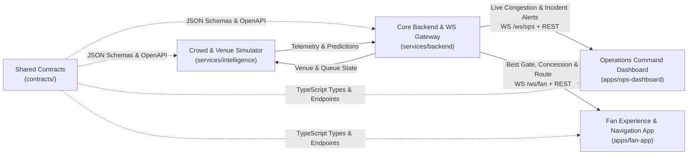

# D.I.S.H.A. — Dynamic Intelligence for Smart Stadium Hospitality & Access

> **Smart Stadium Operations and Fan Experience Platform** (`SPORTS TECH | REAL-TIME SYSTEMS`)

Large stadiums face long entry and concession queues, crowd congestion, delayed incident response, and poor navigation for first-time visitors across disconnected operations systems. **D.I.S.H.A.** solves this by combining real-time crowd, venue, and event telemetry to monitor congestion, dynamically guide fans to less crowded entrances and facilities, and alert operations teams to emerging incidents in real time.

---

## System Architecture



---

## Modular Team Ownership (Strict Isolation)

This repository is structured into **three strictly isolated technical layers** so all three developers—and their Antigravity IDE agents—work concurrently on separate laptops without touching each other's codebases.

| Developer (GitHub) | Layer / Role | Owned Directory | Stack |
| :--- | :--- | :--- | :--- |
| **Atharv Sutar** ([@Atharv-sutar](https://github.com/Atharv-sutar)) | Core Backend & Streaming APIs | [`services/backend/`](services/backend/) | Python, FastAPI, WebSockets, Pydantic |
| **Shreyas DM** ([@Shreyas-D-M](https://github.com/Shreyas-D-M)) | Congestion / Alert Analytics & Simulation | [`services/intelligence/`](services/intelligence/) | Python, NumPy, NetworkX, Crowd/Alert Engine |
| **Ankit Navi** ([@Ankit-Navi-8294](https://github.com/Ankit-Navi-8294)) | Frontend Apps (Ops Dashboard + Fan App) | [`apps/`](apps/) ([`ops-dashboard`](apps/ops-dashboard/), [`fan-app`](apps/fan-app/)) | TypeScript, Next.js / React, Tailwind CSS |

### Shared & Coordination Directories

| Path | Purpose | Who Edits |
| :--- | :--- | :--- |
| [`.agents/`](.agents/) | Shared Antigravity rules, skills, ownership registry, and cross-agent sync ledger | Rules/registry by consensus; each dev edits **only their own** `.agents/sync/status/<handle>.md` |
| [`contracts/`](contracts/) | JSON Schemas, stadium topology contract, and REST/WebSocket endpoint specifications | Coordinated via `.agents/sync/handoffs/` proposals |
| [`docs/`](docs/) | System architecture and team collaboration workflow guides | Shared documentation |
| [`.github/CODEOWNERS`](.github/CODEOWNERS) | GitHub code ownership enforcement matching the 3-way split | Repo maintainers |

---

## Repository Structure

```text
D.I.S.H.A/
├── .agents/                        # Antigravity IDE auto-discovery rules, skills & cross-laptop agent sync
│   ├── ownership.json              # Machine-readable developer -> directory ownership map
│   ├── TEAM.md                     # Team roster, boundaries & collaboration contract
│   ├── rules/                      # Auto-loaded workspace & glob-scoped agent rules
│   ├── skills/                     # Reusable sync, commit-push, and contract-handoff workflows
│   ├── sync/
│   │   ├── status/                 # Conflict-free per-developer status logs
│   │   └── handoffs/               # Dated cross-module API/schema proposals
│   └── scripts/                    # Developer identity & boundary verification scripts
├── .github/
│   └── CODEOWNERS                  # Enforces module ownership on GitHub
├── apps/                           # [Ankit-Navi-8294] Frontend Applications
│   ├── ops-dashboard/              # Stadium Operations Command Center (heatmaps, queue monitors, alerts)
│   └── fan-app/                    # Fan Experience & Smart Navigation App (gate/concession wayfinding)
├── services/
│   ├── backend/                    # [Atharv-sutar] Core FastAPI REST & WebSocket Gateway
│   └── intelligence/               # [Shreyas-D-M] Real-Time Crowd Sim, Congestion & Alert Engine
├── contracts/                      # Shared JSON Schemas & REST/WebSocket interface specifications
├── docs/                           # Architecture and team workflow documentation
├── AGENTS.md                       # Root Antigravity agent instructions
├── GEMINI.md                       # Root Gemini/Antigravity compatibility entrypoint
└── LICENSE                         # MIT License
```

---

## Quickstart for Developers (3 Laptops)

### 1. Clone & Configure Your Git Identity

```bash
git clone https://github.com/Atharv-sutar/D.I.S.H.A.git
cd D.I.S.H.A
```

Ensure your local Git identity matches your team profile in [`.agents/ownership.json`](.agents/ownership.json) so Antigravity IDE automatically knows which module belongs to you:

```bash
# Laptop 1 (Atharv)
git config user.name "Atharv-sutar"
git config user.email "atharvsutar270@gmail.com"

# Laptop 2 (Shreyas)
git config user.name "Shreyas-D-M"
git config user.email "<your-github-email>"

# Laptop 3 (Ankit)
git config user.name "Ankit-Navi-8294"
git config user.email "<your-github-email>"
```

Verify auto-detection and see your teammates' latest status at any time:

```bash
python .agents/scripts/identify_dev.py
```

### 2. How Antigravity Auto-Sync Works

When any of the three developers opens `D.I.S.H.A.` in **Antigravity IDE**:
1. Antigravity automatically loads [`AGENTS.md`](AGENTS.md) and [`.agents/rules/`](.agents/rules/).
2. The agent identifies who is on the laptop using `git config user.name` + [`.agents/ownership.json`](.agents/ownership.json).
3. The agent fetches remote updates (`git fetch origin`) and reads the other two teammates' files in [`.agents/sync/status/`](.agents/sync/status/) and [`.agents/sync/handoffs/`](.agents/sync/handoffs/).
4. The agent **strictly confines all edits** to that developer's owned folder (`services/backend/`, `services/intelligence/`, or `apps/`).
5. After changes, the agent runs `.agents/scripts/check_boundaries.py`, updates the developer's own status file in `.agents/sync/status/`, commits with a descriptive message + `[<github-handle>]`, and pushes to GitHub.

See [`docs/team-workflow.md`](docs/team-workflow.md) and [`docs/architecture.md`](docs/architecture.md) for full details.

---

## Mandatory Git Rules

1. **ALWAYS pull before starting any new task**: Run `python .agents/scripts/identify_dev.py --pull` (or `git pull --rebase origin main`) before beginning any task.
2. **Never edit another developer's folder**: Use [`contracts/`](contracts/) and [`.agents/sync/handoffs/`](.agents/sync/handoffs/) to coordinate cross-layer changes.
3. **Always commit and push after meaningful changes** with a clear Conventional Commit message and your GitHub username:
   ```text
   <type>(<module>): <concise description> [<github-handle>]
   ```
   Example: `feat(backend): add WebSocket live queue stream [Atharv-sutar]`
4. **Verify boundaries before pushing**:
   ```bash
   python .agents/scripts/check_boundaries.py
   ```
